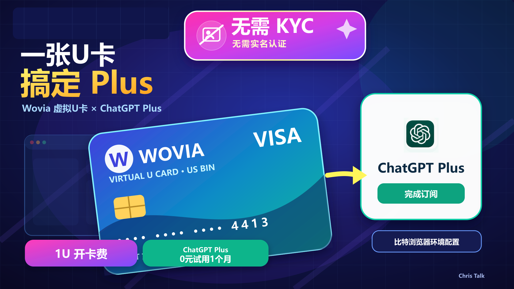
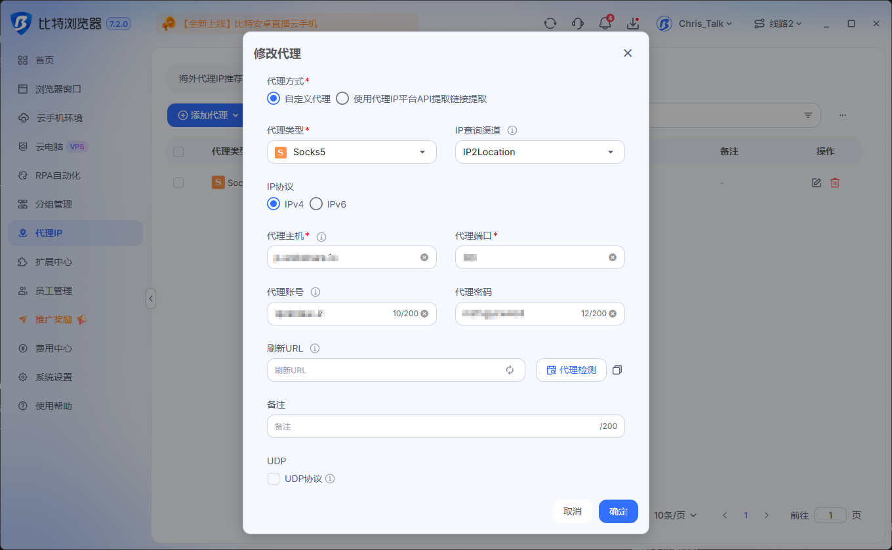
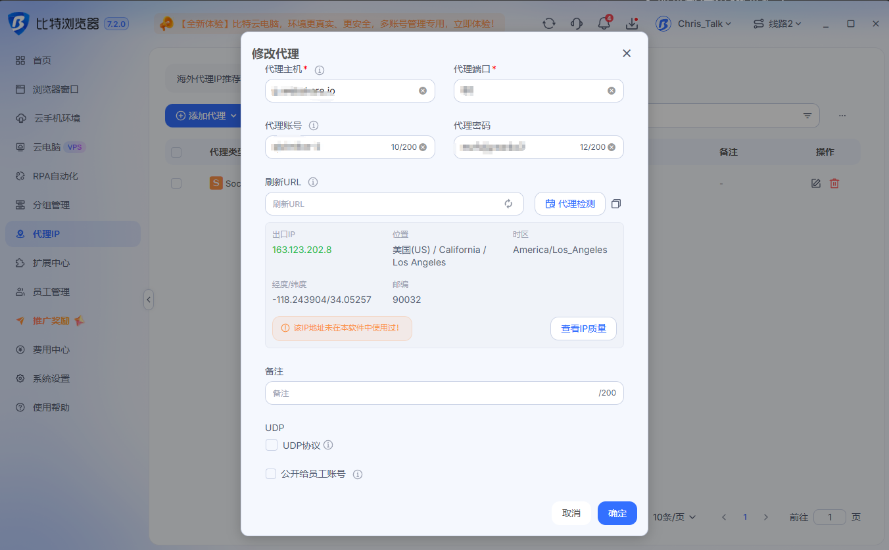

# 🎁 比特指纹浏览器配置环境，并使用 Wovia 虚拟卡白嫖一月 ChatGPT

{ style="display:block; width:900px; max-width:100%; height:auto; margin:24px auto 14px; border-radius:10px; box-shadow:0 6px 18px rgba(0,0,0,0.16);" }

  <a href="https://youtu.be/6hosHx-Ad_A?si=Zc1F3W6XavDwDPI_"
     target="_blank"
     rel="noopener noreferrer"
     class="md-button md-button--neutral"
     style="display: inline-flex; align-items: center; justify-content: center; gap: 8px; padding: 10px 24px; font-size: 0.85rem; border-radius: 20px; text-decoration: none; font-weight: bold; border: 1px solid rgba(0,0,0,0.1); transition: all 0.3s ease;">
    
      
    
    立即观看完整视频
  </a>

---

**本期要点：** 本教程演示如何创建一个独立的比特浏览器环境，配置网络代理，登录 ChatGPT，并使用 Wovia 虚拟卡白嫖一月 ChatGPT。

<!-- more -->
---

## 🔗 相关链接

### 本期使用工具

- **比特指纹浏览器：** [点击注册或下载](https://www.bitbrowser.cn/?code=EXOste)

- **Wovia 虚拟卡：** [点击邀请链接注册](https://app.wovia.global/?ref=asbROn49Gd)  
  **邀请码：** `asbROn49Gd`

### 网络代理

- **Webshare 住宅代理：** 👉 [点击注册 Webshare](https://www.webshare.io/?referral_code=lq6qy4n0ui6c)

- **Webshare 配套教程：** [住宅代理购买与比特浏览器配置教程](https://youtu.be/LdflraxfvEs?si=0ecgjjFJXxbfFQwb)

### 其他工具与交流

- **TG 交流群：** [点击加入](https://telegram.me/+BwyeTrhg9NQ5MjVl)

- **美国地址格式参考工具：** [点击跳转](https://www.meiguodizhi.com/)

## 🔍 IP 工具

- **IP 检测工具：**
    - [Ping0](https://ping0.cc/)（查询当前网络 IP 地址类型）
    - [IP.NET](https://ip.net.coffee/)
    - [IPOK](https://ipok.io/)
    - [IPIPAI](https://ipipai.com/index-zh.html)

- **Speedtest 网络测速：**[点击测速](https://www.speedtest.net/)

## 一、准备工作

开始之前，需要提前准备：

- 已安装的比特指纹浏览器；
- 可以正常登录的 ChatGPT 账号；
- 自己有权使用的网络或代理服务；
- 已开通并充值的 Wovia 虚拟卡；
- 可以接收登录验证码的邮箱或手机号。

---

## 二、配置代理网络

在创建窗口页面找到 **“代理设置”**。

根据代理服务商提供的资料，依次填写：

- 代理协议；
- 代理主机；
- 代理端口；
- 代理账号；
- 代理密码。

填写完成后，点击 **“代理检测”**，确认代理可以正常连接。

<!-- 截图3：代理主机、端口、账号和密码 -->

检测成功后，再检查以下设置：

- 时区是否与当前网络地区一致；
- 语言是否符合实际使用情况；
- 地理位置是否设置为跟随 IP；
- 页面显示的 IP 地址是否正确。

> 这里的重点是保持网络、时区和语言设置稳定，并与真实使用资料一致。不要为了付款虚构地区或账单资料。

<!-- 截图4：代理检测成功及地区设置 -->

---

## 三、创建比特浏览器环境

打开比特浏览器，进入左侧的 **“浏览器窗口”** 页面，然后点击 **“创建窗口”**。

建议填写：

- **窗口名称：** ChatGPT订阅；
- **浏览器：** BitBrowser；
- **设备类型：** PC；
- **操作系统：** Windows；
- **浏览器内核：** 选择当前稳定版本；
- **分组和标签：** 可以根据自己的账号用途填写。

没有特殊需求的指纹项目，可以先保持默认设置，不建议在使用过程中频繁修改。

<!-- 截图1：圈出“创建窗口”按钮 -->

<!-- 截图2：浏览器、设备和操作系统设置 -->

---

## 四、打开环境并登录 ChatGPT

保存环境后，返回浏览器窗口列表，点击 **“打开”**。

在新打开的浏览器中访问：

[https://chatgpt.com/](https://chatgpt.com/)

点击 **“登录”**，使用自己的邮箱、Google 账号或其他可用方式完成登录。

如果系统要求进行邮箱验证或安全验证，按照页面提示操作即可。

<!-- 截图5：打开比特浏览器环境 -->

<!-- 截图6：ChatGPT登录页面 -->

---

## 五、进入 ChatGPT 套餐订阅页面

登录 ChatGPT 后，点击左下角的账号头像，在菜单中找到：

**升级套餐 / Upgrade Plan / Get Plus**

不同账号看到的按钮名称可能略有区别，以实际页面为准。

进入套餐页面后，选择需要订阅的套餐，例如 **ChatGPT Plus**。

写作本文时，官方套餐页面显示 Plus 为每月 20 美元，最终价格、税费和可用套餐请以结账页面为准：

[查看 ChatGPT 官方套餐说明](https://learn.chatgpt.com/docs/pricing)

<!-- 截图7：圈出“升级套餐”入口 -->

<!-- 截图8：选择ChatGPT套餐 -->

---

## 六、准备 Wovia 虚拟卡

本教程默认已经完成 Wovia 注册、开卡和充值，不再展开开卡过程。

打开 Wovia，进入卡片页面，选择准备使用的虚拟卡，然后查看：

- 卡号；
- 有效期；
- CVV 安全码；
- 持卡人资料；
- 平台提供的账单资料；
- 当前可用余额。

付款前需要确认：

1. 卡片处于正常状态；
2. 余额可以覆盖订阅金额、税费和可能产生的交易费用；
3. 如果页面提供网络支付、国际支付或订阅支付开关，需要确认已经开启；
4. 卡片产品是否明确支持当前使用场景。

> Wovia 不同卡产品或卡段的适用范围可能不同，能否付款以 Wovia 当前页面、发卡机构和 ChatGPT 结账结果为准。

<!-- 截图9：Wovia卡片列表，注意隐藏敏感信息 -->

<!-- 截图10：卡片详情页，必须遮挡卡号、CVV等信息 -->

---

## 七、填写付款资料

返回 ChatGPT 的结账页面，按照页面要求填写：

- **Card Number：** Wovia 卡号；
- **Expiration Date：** 卡片有效期；
- **CVC/CVV：** 卡片安全码；
- **Name on Card：** 与发卡平台记录一致的持卡人姓名；
- **Billing Address：** 与发卡平台记录一致的真实账单资料；
- **Postal Code：** 对应账单地址的邮政编码。

不要随机填写账单地址。如果 Wovia 页面没有提供明确的账单资料，应先咨询发卡平台客服。

填写完成后，确认：

- 套餐名称；
- 实际扣款金额；
- 税费；
- 自动续费说明。

确认没有问题后，再点击订阅或付款按钮。提交一次后先等待页面返回结果，不要连续重复点击。

<!-- 截图11：ChatGPT付款页面，隐藏所有个人和卡片信息 -->

---

## 八、完成支付验证

提交付款后，可能出现以下情况：

- 直接付款成功；
- Wovia 应用内确认；
- 3D Secure 验证；
- 短信或邮箱验证码；
- 小额预授权。

如果页面要求验证，按照发卡平台的提示完成即可。

<!-- 截图12：付款验证页面 -->

---

## 九、检查订阅结果

支付成功后，ChatGPT 页面通常会显示订阅成功。

可以进入账号设置，查看：

- 当前套餐名称；
- 下次续费日期；
- 付款方式；
- 账单或订阅管理入口。

同时进入 Wovia 查看扣款记录，确认金额是否正确。

<!-- 截图13：ChatGPT订阅成功页面 -->

<!-- 截图14：套餐管理页面 -->

---

## 十、自动续费提醒

ChatGPT 套餐通常会按照订阅周期自动续费。

如果准备继续使用，需要在续费日前确保卡片状态正常、余额充足。如果不需要继续订阅，可以提前进入 ChatGPT 的套餐管理页面取消自动续费。

具体续费日期和取消结果，以账号中的订阅管理页面为准。

---

## 总结

本期完成的主要流程是：

**创建比特浏览器环境 → 配置代理网络 → 登录 ChatGPT → 选择套餐 → 填写 Wovia 卡片资料 → 完成支付验证 → 检查订阅状态**

支付是否成功，最终仍取决于账号资格、卡片状态、发卡机构审核以及结账页面的实际结果。