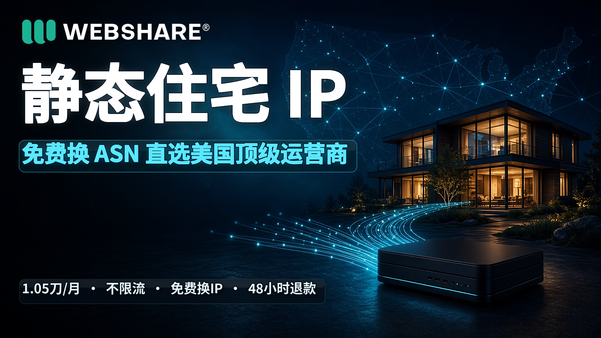

# 🎁 Webshare 静态住宅代理配置教程：带宽选择、前置代理与 IP 检测

{ style="display:block; width:900px; max-width:100%; height:auto; margin:24px auto 14px; border-radius:10px; box-shadow:0 6px 18px rgba(0,0,0,0.16);" }

  <a href="https://youtu.be/LdflraxfvEs?si=fYgGzxMLMP1JuaL_"
     target="_blank"
     rel="noopener noreferrer"
     class="md-button md-button--neutral"
     style="display: inline-flex; align-items: center; justify-content: center; gap: 8px; padding: 10px 24px; font-size: 0.85rem; border-radius: 20px; text-decoration: none; font-weight: bold; border: 1px solid rgba(0,0,0,0.1); transition: all 0.3s ease;">
    
      
    
    立即观看完整视频
  </a>

---

**本期要点：** 从零搭建一套适合长期使用的 v2rayN 分流规则集，让局域网和国内流量直连，广告域名直接阻断，ChatGPT、Gemini 与流媒体统一使用美国住宅出口，交易所固定使用单独的香港节点，其余境外流量则交给当前代理节点。

<!-- more -->

## 🔗 本期相关服务推荐

### 🌐 静态住宅 IP

- 👉 **本期视频同款静态 IP（Webshare）：** [点击跳转](https://www.webshare.io/?referral_code=lq6qy4n0ui6c)

### 🖥️ VPS推荐
- **NodeMach 精品线路 VPS（CN2 GIA，含 IPv4 + /64 IPv6）：** [Chris 专属链接，购买与续费终身额外享 95 折](https://www.nodemach.com/welcome?vcd=9f2694fe)
- **各价位VPS推荐：** [点击查看](https://lanyun122.github.io/blog/recommend/1-vps/)

## 📱 代理工具

- **Windows / macOS（Clash Verge Rev）：**[点击跳转](https://github.com/Clash-Verge-rev/clash-verge-rev/releases/latest)

- **v2rayN：** [GitHub Releases 下载最新版](https://github.com/2dust/v2rayN/releases/latest)

- **Android（NekoBox）：**[点击跳转](https://github.com/MatsuriDayo/NekoBoxForAndroid/releases)

- **iOS / macOS（Shadowrocket）：**[点击跳转](https://apps.apple.com/us/app/shadowrocket/id932747118)

### 🎬 链式代理配置教程

用静态住宅 IP 做前置代理时，可按下面两条视频配置链式代理。

**iOS（Shadowrocket / 小火箭）：** [点击观看教程](https://youtu.be/tQCkRt8d5NA)

**Windows / macOS（Clash Verge）：** [点击观看教程](https://youtu.be/UvU213ebRQE)

## 🔍 IP 质量检测工具

- 👉 **[Ping0](https://ping0.cc/)（查询当前网络 IP 纯净度）**
- 👉 **[IPinfo](https://ipinfo.io/tools/pingable-ips)（查询当前网络 IP 类型以及ASN）**
- 👉 **[ip.net IP 检测](https://ip.net.coffee/)**
- 👉 **[ipok.io IP 检测](https://ipok.io/)**
- 👉 **[IPIPAI IP 检测](https://ipipai.com/index-zh.html)**

## 💳 国际支付方式

### 🌐 国际虚拟卡

- **Bybit U 卡申请教程：**

  [▶ Bybit U卡（台湾）](https://partner.bybit.com/b/148332)
  [▶ Bybit U卡（哈萨克斯坦）](https://partner.bybit.com/b/148332)

### 🏦 实体银行卡

- **招商银行万事达人民币普卡（实体借记卡）：**

  [▶ 前往招商银行官方渠道申请](https://market.cmbchina.com/MPage/online/240909170402139/wsdsjk/index.html)

  > 打开招商银行 App，搜索“万事达普卡”，按照页面提示提交申请。

### 美国地址生成器
- **美国地址格式参考工具：** [点击跳转](https://www.meiguodizhi.com/)

---

## 🆓 免费导入分流规则

 v2rayN 分流规则集已经免费开源到 GitHub，项目主页提供规则地址及导入说明：

👉 **[点击进入 v2rayN Smart Routing 项目](https://github.com/lanyun122/v2rayN-Smart-Routing)**

进入项目后复制规则地址，在 v2rayN 的路由设置中通过订阅 URL 导入即可。

> ⭐ 这套规则可以直接免费使用，点亮 Star 并不是使用条件。如果项目确实帮助到了你，我想真诚地邀请你为项目点亮一个 **Star**。我希望参与 Codex 后续面向 GitHub 创作者的相关活动，你的支持对我非常重要；我也会继续免费维护和分享实用内容，期待和大家互相帮助、共同成长。

---

## Webshare 优势

| 优势 | 说明 |
| --- | --- |
| 带宽不限流 | 套餐带宽不限流 |
| 价格便宜 | 原价 1.5 刀/月 年付月均1.05刀/月|
| 免费更换 IP | 可免费直接更换 IP |
| 48 小时全额退款 | 购买后 48 小时内可申请全额退款 |
| 超期按使用折算退余额 | 超过退款期可按使用时长折算退回账户余额，不打折，需要时再重新订阅 |
| 两种换节点方式 | 可按国家选择（如美国换英国），也可按 ASN 更换宽带供应商，获得 AT&T、Comcast 等美国头部运营商的住宅 IP |
| 对比同类价格 | 有商家把 Comcast 住宅 IP 卖到 10 美元一个月，一两月就卖断货；WebShare 只要 1.5 美元一个月 |

---

## 美国前 5 大宽带运营商

按宽带用户数排序，数据截至 2026 年 9 月 30 日（各公司 2026 年三季报）。

| 排名 | 公司 | 品牌 | 宽带用户 | 备注 |
| --- | --- | --- | --- | --- |
| 1 | Charter Communications | Spectrum | 约 3431 万 | 2026 年 8 月完成收购 Cox，用户已并入 |
| 2 | Comcast | Xfinity | 约 2834 万 | 美国国内住宅宽带用户 |
| 3 | Verizon | Fios / 5G Home | 约 1740 万 | 含光纤和固定无线 |
| 4 | AT&T | AT&T Fiber / Internet Air | 约 1625 万 | 含光纤约 1331 万、固定无线约 294 万 |
| 5 | T-Mobile | 5G Home Internet | 至少 845 万 | 这是 2025 年底官方数；2026 年三季报未再公布总数，但仍明显高于其后的 Optimum 等 |